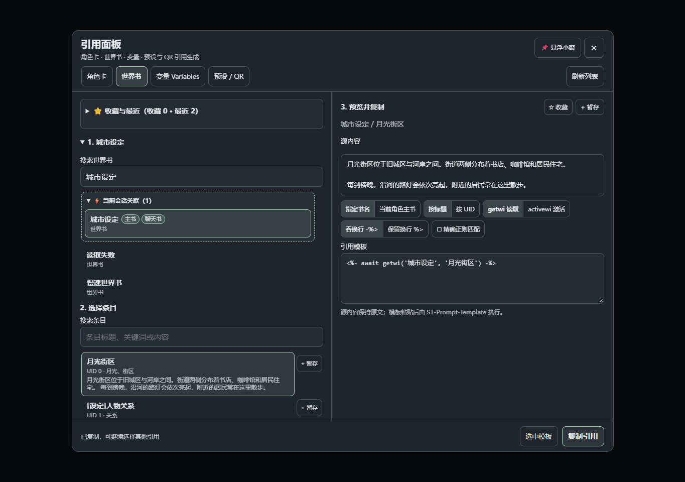
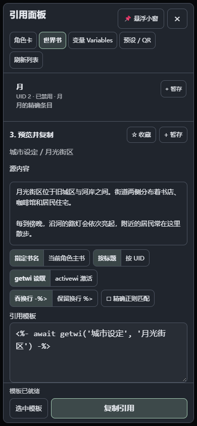

# 引用面板 · ST Reference Panel

一个独立的 SillyTavern 扩展，用来浏览并检索**角色卡字段、世界书条目、酒馆变量、对话预设提示词与快速回复（QuickReply v2）**，一键生成、复制或直接插入 [ST-Prompt-Template](https://github.com/zonde306/ST-Prompt-Template) 的 EJS 引用模板。

## 通过 GitHub URL 安装

1. 在 SillyTavern 打开 **扩展 → 安装扩展**。
2. 粘贴仓库地址：

   ```text
   https://github.com/GalliumWang/ST-Reference-Panel
   ```

3. 完成安装后刷新页面，确认“引用面板 · Reference Panel”已启用。
4. 从聊天输入框旁的扩展菜单（魔棒菜单）点击 **引用面板**，或在扩展设置页点击 **打开引用面板**。

需要安装并启用 [ST-Prompt-Template](https://github.com/zonde306/ST-Prompt-Template)，它负责在发送消息或渲染提示词时执行 EJS 引用模板。本扩展直接加载原生 ES Module 文件，无需构建步骤，零运行时外部依赖。

## 手动安装

1. 确保 SillyTavern 已安装并启用 ST-Prompt-Template。
2. 解压发布包 `ST-Reference-Panel-v1.1.0.zip`，将 `ST-Reference-Panel` 文件夹放入酒馆扩展目录：

   ```text
   SillyTavern/data/<用户目录>/extensions/ST-Reference-Panel/
   ```

   或全局扩展目录：

   ```text
   SillyTavern/public/scripts/extensions/third-party/ST-Reference-Panel/
   ```

   文件夹根目录应直接包含 `manifest.json`、`index.js`、`core.js`、`adapter.js`、`panel.js`、`clipboard.js` 和 `style.css`。
3. 刷新酒馆页面即可使用。

## 界面预览

下图使用虚构的角色、世界书、变量与预设数据生成：





## 核心功能（v1.1.0）

### 1. 四大引用页签与多模板胶囊切换

#### 角色卡（`characters`）
- 支持按角色名、文件名以及**酒馆 UI 标签**（合并 `tagMap` + 内嵌 `tags`）搜索。
- 提供常用字段快捷入口与完整嵌套字段树（含数组下标、特殊键名精确路径）。
- 模板胶囊选项：
  - **指定角色 / 动态当前角色**：切换 `<%- (await getCharData('林晚'))?.description ?? '' %>` 与通用预设模板 `<%- (await getCharData())?.description ?? '' %>`。
  - **兼容懒加载**：自动检测服务端角色懒加载（`shallow`），按名称动态求取下标执行 `await SillyTavern.unshallowCharacter?.(...)` 后读取数据，且浏览面板不会切换当前聊天。
  - **精确正则匹配**：当角色名含正则元字符、与 `Array.prototype` 属性重名（如 `map`、`length`）或存在包含关系时自动启用锚定正则 `new RegExp('^...$')`，也可手动强制开启。

#### 世界书（`worlds`）
- 自动识别并置顶当前会话绑定的 5 类世界书，标注 `[主书]`、`[附加书]`、`[聊天书]`、`[Persona 书]`、`[全局书]` 徽章。
- 模板胶囊选项：
  - **指定书名 / 当前角色主书**：切换双参数 `getwi('书名', '条目')` 与单参数主世界书引用 `getwi('条目')`。
  - **按标题 / 按 UID**：支持按条目标题（`comment`）或数字 `UID`（如 `<%- await getwi('城市设定', 12) -%>`）定位，无标题条目也可直接按 UID 引用；若同书存在包含该数字子串的条目标题会自动提示命中顺序风险。
  - **getwi 读取 / activewi 激活**：一键切换内容嵌入 `<%- await getwi(...) -%>` 与动态激活 `<% await activewi(...) -%>`。
  - **吞换行 `-%>` / 保留换行 `%>`** 及 **精确正则匹配**。

#### 变量（`variables`）
- 聚合展示**合并生效视图**、**聊天局部变量（`local`）**、**全局变量（`global`）**、**最新楼层消息变量（`message`）**，并自动扫描当前关联世界书中标题含 `[InitialVariables]` 或正文含 `@@initial_variables` 的 JSON / YAML 初始变量结构。
- 支持嵌套变量树点选与**手动输入任意自定义变量路径**（如 `stat.hp`、`flags.met_lin`）。
- 支持一键切换生成 `getvar`、`setvar`、`incvar` 与 `if (getvar(...)) { ... }` 条件块，并可指定作用域参数（默认 / `local` / `global` / `message`）。

#### 预设 / 快速回复（`presets`）
- 读取对话补全预设（Chat Completion Presets）提示词列表，默认生成符合 ST-Prompt-Template 单参数签名的 `<%- await getpreset('条目名') -%>`（运行时读取当前激活预设）；浏览非当前激活预设时可切换为**指定预设静态读取**模式。
- 读取 QuickReply v2 全局与聊天快速回复集合，生成 `<%- await getqr('集合名', '标签名') -%>`。

### 2. 高效工作流增强

- **⚡ 当前会话关联置顶**：每个页签顶部自动将当前角色、群聊成员、绑定世界书、当前预设与启用 QR 归入可折叠的关联分组。
- **⭐ 收藏与最近历史**：常用引用模板可一键加星置顶，复制或插入过的模板自动记录到最近列表（持久化于 `extensionSettings.st_reference_panel`）。
- **🧺 引用暂存篮（批量复制 / 批量插入）**：任意目标行或预览区点击 **+ 暂存**，可将跨页签的多条引用加入底部暂存篮，按序查看、移除、一键批量复制或批量插入。
- **光标处直接插入**：打开面板前若焦点位于酒馆输入框或编辑器（`<textarea>` / `<input>` / `contentEditable`），底部自动显示 **插入光标处** 按钮，一键写回原光标选区并触发 `input` / `change` 事件。
- **📌 悬浮小窗模式**：顶栏支持在**模态窗口**与**非模态悬浮小窗**（`z-index: 3200`）之间无缝切换；悬浮小窗支持拖拽标题栏移动、视口边界防丢保护，以及最小化为右下角胶囊按钮，方便边看世界书编辑器边插引用。
- **实时热同步与穿透刷新**：监听 `WORLDINFO_UPDATED`、`CHARACTER_EDITED`、`CHAT_CHANGED` 等酒馆事件自动热更新；点击 **刷新列表** 会直连 `/api/worldinfo/get` 穿透陈旧缓存并保留当前搜索词、展开树与选中项。

## 跨插件联动接口（`window.STReferencePanel`）

启用后，扩展在 `globalThis.STReferencePanel` 暴露联动 API（禁用扩展时自动卸载），供世界书工作台、预设编辑器等外部插件调用：

```js
// 打开引用面板并接收用户点击“插入引用”或“批量插入”回传的模板
window.STReferencePanel?.open({
    tab: 'worlds',          // 可选：'characters' | 'worlds' | 'variables' | 'presets'
    floating: true,         // 可选：true 以非模态悬浮小窗（z-index: 3200）打开
    onInsert(template, meta) {
        // meta: { mode: 'single' | 'batch', tab, label, ... }
        console.log('插入模板：', template, meta);
    },
});

// 关闭面板
window.STReferencePanel?.close();
```

## 电脑与手机端适配

- **局域网 HTTP 剪贴板兼容**：针对手机通过局域网 `http://192.168.x.x:8000` 访问酒馆（非安全上下文 `isSecureContext === false`）的场景，自动走同步临时解锁选区复制通道并恢复原焦点；若系统策略彻底拦截剪贴板，则自动全选模板并滚动至可视区供长按复制。
- **移动端防遮挡与防缩放**：适配 `visualViewport` 软键盘高度变化、手机横屏矮视口（`max-height: 500px`）紧凑排版，以及触屏输入框 `16px` 字号防 iOS 自动放大。
- **安全预览**：所有角色描述、世界书正文、变量值均以纯文本渲染（无 `innerHTML` 注入），绝不执行其中的脚本或 EJS 代码；超过 8,000 字符的超长原文默认折叠并提供“展开完整原文”按钮。

## 开发、测试与打包

Node.js 22+ 环境下运行语法检查与单元测试：

```bash
npm run check
npm test
```

使用 ST-Prompt-Template 原生 EJS 引擎运行编译集成验证：

```bash
ST_REFERENCE_EJS_PATH=/path/to/ST-Prompt-Template/src/3rdparty/ejs.js node tests/ejs.integration.mjs
```

运行真实浏览器端到端验证（桌面端 + 手机多分辨率触屏模拟）：

```bash
ST_REFERENCE_TEST_MODULES=/path/to/node_modules npm run test:browser
```

构建发布 ZIP 包（自动从 `manifest.json` 读取版本号生成 `ST-Reference-Panel-v<version>.zip`）：

```powershell
powershell -ExecutionPolicy Bypass -File .\tools\package.ps1
```

## 参考接口

- [SillyTavern UI 扩展文档](https://docs.sillytavern.app/for-contributors/writing-extensions/)
- [SillyTavern 上下文接口](https://github.com/SillyTavern/SillyTavern/blob/release/public/scripts/st-context.js)
- [ST-Prompt-Template API 文档](https://github.com/zonde306/ST-Prompt-Template/blob/main/docs/reference.md)

许可：MIT。实现为独立代码，安装包不包含 ST-Prompt-Template 的源代码。
