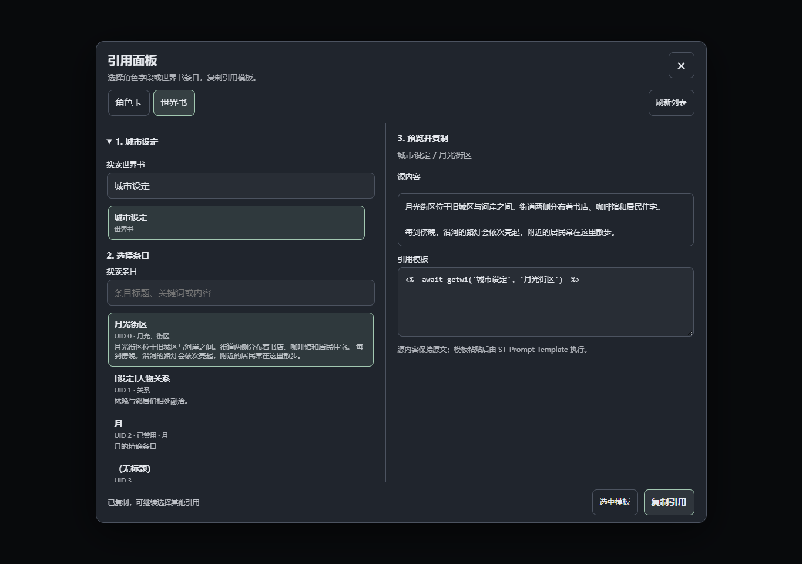
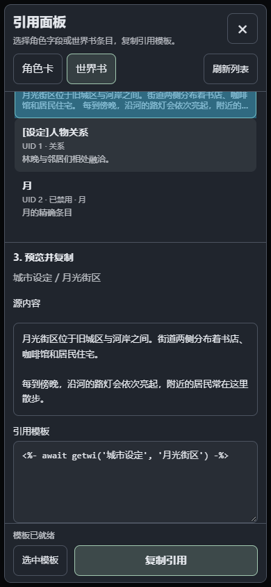

# 引用面板 · ST Reference Panel

一个独立的 SillyTavern 扩展，用来搜索角色卡字段和世界书条目，并复制 [ST-Prompt-Template](https://github.com/zonde306/ST-Prompt-Template) 的 EJS 引用模板。

## 通过 GitHub URL 安装

1. 在 SillyTavern 打开 **扩展 → 安装扩展**。
2. 粘贴仓库地址：

   ```text
   https://github.com/GalliumWang/ST-Reference-Panel
   ```

3. 完成安装后刷新页面，确认“引用面板 · Reference Panel”已启用。
4. 从聊天输入框附近的扩展菜单打开“引用面板”。扩展设置页也有“打开引用面板”按钮。

需要安装并启用 [ST-Prompt-Template](https://github.com/zonde306/ST-Prompt-Template)，它负责执行引用模板。仓库根目录直接提供扩展运行文件，无需构建。

电脑和手机连接同一个酒馆服务器时，安装一次后分别刷新页面即可。

## 手动安装

1. 确保 SillyTavern 已安装并启用 ST-Prompt-Template。它负责执行复制出来的模板。
2. 解压安装包，把整个 `ST-Reference-Panel` 文件夹放到酒馆的用户扩展目录：

   ```text
   SillyTavern/data/<用户目录>/extensions/ST-Reference-Panel/
   ```

   默认用户通常是 `default-user`。文件夹内应直接包含 `manifest.json`、`index.js`、`core.js`、`adapter.js`、`panel.js`、`clipboard.js` 和 `style.css`，避免多套一层目录。

   如果希望对服务器上的所有用户安装，也可以放到：

   ```text
   SillyTavern/public/scripts/extensions/third-party/ST-Reference-Panel/
   ```

3. 刷新酒馆页面，在扩展管理中确认“引用面板 · Reference Panel”已启用。
4. 从聊天输入框附近的扩展菜单打开“引用面板”。扩展设置页也提供“打开引用面板”按钮。

电脑和手机连接同一个酒馆服务器时，安装一次后分别刷新页面即可。连接不同服务器时，需要分别安装。扩展直接加载 JavaScript 文件，无需运行 npm 或编译。

## 界面预览

下图使用虚构的角色和世界书数据。





## 使用

### 引用角色字段

1. 打开“角色卡”页签，用角色名、卡文件名或标签搜索。
2. 选择角色。常用字段提供中文名称；展开“全部字段”可逐层选择任意嵌套字段和数组元素。
3. 搜索字段时会搜索完整字段树，包括尚未展开的字段。
4. 查看源内容和模板，点击“复制引用”，再粘贴到需要引用它的角色卡、世界书或其他支持 EJS 的文本位置。

普通文本字段的模板示例：

```ejs
<%- (await getCharData('林晚'))?.description ?? '' %>
```

未找到角色或字段时输出空文本。数字 `0` 和布尔值 `false` 会保留。

对象、数组会自动生成 `JSON.stringify(..., null, 2)`，输出可读的 JSON 文本。若只需要备用开场白中的一条，可以展开 `data` → `alternate_greetings` → 对应下标。

开启角色懒加载时，模板会加入 `SillyTavern.unshallowCharacter(...)` 的完整数据读取步骤；角色下标在执行时按名称查找，避免导入或排序后指向其他卡。此功能需要酒馆提供该接口。面板按需加载选中的角色，不会切换当前聊天。

### 引用世界书条目

1. 打开“世界书”页签，搜索并选择世界书。
2. 按标题、关键词或内容搜索条目。
3. 选择条目并点击“复制引用”。

普通名称的模板示例：

```ejs
<%- await getwi('城市设定', '月光街区') -%>
```

**引用使用条目的标题／备注（`comment`），始终按名称定位。** 列表里的 UID 仅用于帮助辨认条目。未启用的世界书和禁用的条目也会列出，读取内容遵循 ST-Prompt-Template 的 `getwi()` 行为。

原插件会将角色名和条目名参与正则匹配。若名称含正则符号，或另一个名称包含它，面板会自动生成按名称精确匹配的 `new RegExp(...)` 参数。例如：

```ejs
<%- await getwi('城市设定', new RegExp('^\\[设定\\]人物关系$')) -%>
```

这仍然引用条目名称，避免读到相似标题。引号、反斜杠、换行、EJS 分隔符等会自动转义。

## 电脑与手机

- 电脑使用左右分栏：左侧选择目标，右侧预览。
- 手机使用上下排列，选择角色或世界书后自动收起来源列表。底部始终保留复制按钮。
- 复制后面板保持打开，方便继续选择引用。记住上次使用的页签。
- 可用“选中模板”按钮手动复制。自动复制遇到浏览器权限或环境限制时，也会选中完整模板并提示使用系统复制菜单。
- 电脑支持 Tab 键导航、左右方向键切换页签，以及 Esc 关闭面板。

## 提示与限制

- 空标题的世界书条目可以预览，需要先填写标题／备注才能生成名称引用。
- 同名角色或同一本书里的同名条目会显示提示。原插件可能读取第一个同名目标，当前预览无法消除同名歧义；建议先给它们不同的名称。
- 修改角色名、世界书名或条目名之后，需要重新复制引用。
- 源内容预览显示原始文本。面板不会执行其中的 EJS，也不会模拟嵌套引用展开；粘贴后的最终行为由 ST-Prompt-Template 和酒馆设置决定。
- 世界书模板保留 `-%>`，与既定格式一致，会移除紧随模板后的第一个换行。
- 当前生成默认分隔符 `<% ... %>` 的 EJS 模板。
- 用“刷新列表”重新读取可选来源和所选内容。通过酒馆的世界书读取接口加载数据，遵循它的缓存行为。
- 运行时无需第三方库，不修改角色卡、世界书或聊天内容；仅保存上次使用的页签。

## 开发与验证

Node.js 22 下运行基础测试：

```text
npm test
```

浏览器验证需要可用的 `playwright` 包与 Chrome（可通过 `ST_REFERENCE_BROWSER` 选择其他已安装通道）。运行 `npm run test:browser`，测试直接加载扩展入口和样式，使用虚构数据检查复制、搜索、异步读取、生命周期和手机布局。可通过 `ST_REFERENCE_TEST_MODULES` 指定包含 `playwright` 的依赖目录。

`tests/ejs.integration.mjs` 使用原插件的实际 EJS 引擎校验模板。设置 `ST_REFERENCE_EJS_PATH` 指向 `ST-Prompt-Template/src/3rdparty/ejs.js` 后运行该文件。

## 参考接口

- [SillyTavern UI 扩展文档](https://docs.sillytavern.app/for-contributors/writing-extensions/)
- [SillyTavern 上下文接口](https://github.com/SillyTavern/SillyTavern/blob/release/public/scripts/st-context.js)
- [ST-Prompt-Template API 文档](https://github.com/zonde306/ST-Prompt-Template/blob/main/docs/reference.md)

许可：MIT。实现为独立代码，安装包不包含 ST-Prompt-Template 的源代码。
